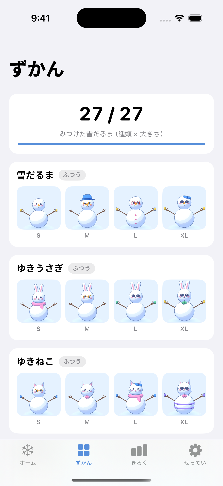

# ゆきころさんぽ

  

（上の画像は、CI のシミュレーターで撮ったデモ表示です。）

歩くと雪玉がころころ大きくなる。転がしながら刃で削って形を整え、色を付けて、複数の雪玉を組み合わせて雪の彫刻（作品）を作る、のんびり系の iOS アプリ（iOS 17+、SwiftUI）。

- 企画の背景と設計方針: [DESIGN.md](DESIGN.md)
- プライバシー: [PRIVACY.md](PRIVACY.md)

## 中身

| 場所 | 役割 |
|---|---|
| `Shared/` | ゲームロジック（歩数の台帳、雪玉の形と削り・成長、作品の組み立て）、保存、HealthKit。アプリ・テストで共有 |
| `App/` | 画面（ホーム・ゆきだま・さくひん・きろく・せってい・整える画面）と、雪玉の2D描画 |
| `Resources/Backgrounds/` | 背景の写真（CC0。昼・夕方・夜）。出典は `CREDITS.md`。`tools/make_backgrounds.py` で作成 |
| `Tests/` | 単体テスト |
| `project.yml` | [XcodeGen](https://github.com/yonaskolb/XcodeGen) の設定（`Yukikoro.xcodeproj` はここから生成） |
| `tools/make_icon.py` | アプリアイコンの生成スクリプト |

雪玉・作品はすべて2D（横から見た絵）で描いているので、軽く動きます。

## 開く・動かす（Mac）

`Yukikoro.xcodeproj`（と、それが参照する `Info.plist`・権限ファイル）はリポジトリに含まれているので、そのまま Xcode 16 以降で開けます。

`project.yml` を変えたときだけ、プロジェクトを作り直します（CI でも毎回生成して検証しています）。

```bash
brew install xcodegen
xcodegen generate
```

実機で歩数を確認するには、実機（iPhone）を選んで実行します。シミュレーターでは歩数が増えないので、**設定画面のバージョンを5回タップ**すると出る「テスト用」メニューで歩数を足せます。

## TestFlight に出す

**手順書: [docs/TESTFLIGHT.md](docs/TESTFLIGHT.md)**（はじめてでも分かるように、順番に書いてあります。Mac がある場合とない場合の両方）。

要点だけ書くと、次のとおりです。

1. Apple Developer Program に加入する（年会費が必要）。
2. **Bundle ID を自分のものに変える**: `python tools/set_bundle_id.py com.yourname.yukikoro --team <TeamID>`（アプリ・テスト用の設定を一括で書き換えます）。
3. App Store Connect でアプリを作る。
4. Xcode で Archive してアップロードする（Mac なしの場合は、GitHub Actions の手動ワークフロー。未検証）。
5. TestFlight でテスターを招待して、iPhone にインストールする。

## 検証（CI）

push のたびに GitHub Actions（macOS）が、アプリのビルドと単体テストを実行します。ローカルに Mac がなくても、コンパイルとロジックの確認ができます。画面の見た目と実機の歩数取得は、実機（TestFlight）でしか確認できません。

## 背景を自前の写真に差し替える

`Resources/Backgrounds/bg_day.jpg` `bg_dusk.jpg` `bg_night.jpg` を、同じ名前の画像で置き換えてください（縦横比は自由。画面いっぱいに拡大して表示します）。

## 既知の制限

- 背景は 1k の写真から作った画像なので、拡大するとぼけて見えます。より精細にするには、高解像度の画像に差し替えてください。

- ホーム画面ウィジェットは、最初の TestFlight では外しました（実装は Git のタグ `with-widget` に残してあります）。
- 歩数の追加は、アプリを開いたとき（15秒ごと）に行います。開いていない間に歩いた分は、次に開いたときにまとめて加算されます（直近7日分まで）。
- 効果音・通知・フレンド機能・課金・ウィジェットは v1 には入っていません（理由は DESIGN.md）。
