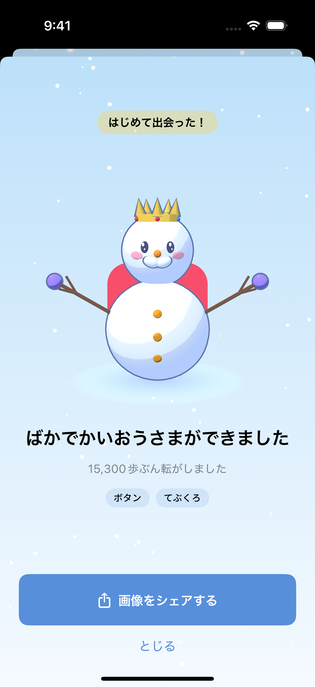

# ゆきころ

  

（上の画像は、CI のシミュレーターで撮ったデモ表示です。）

歩くと雪玉がころころ大きくなり、好きな大きさで雪だるまにして図鑑を集める、のんびり系の iOS アプリ（iOS 17+、SwiftUI）。

- 企画の背景と設計方針: [DESIGN.md](DESIGN.md)
- プライバシー: [PRIVACY.md](PRIVACY.md)

## 中身

| 場所 | 役割 |
|---|---|
| `Shared/` | ゲームロジック（歩数の台帳・サイズ段階・種類と飾りの抽選）、保存、HealthKit。アプリ・ウィジェット・テストで共有 |
| `Shared3D/` | 3D の雪だるま・雪玉（SceneKit、トゥーン調シェーダと輪郭線）。アプリとテストで共有 |
| `App/` | 画面（ホーム・ずかん・せってい・最初の説明・完成シート・共有画像） |
| `Widget/` | ホーム画面ウィジェット（小・中） |
| `Tests/` | ゲームロジックの単体テスト |
| `project.yml` | [XcodeGen](https://github.com/yonaskolb/XcodeGen) の設定（`Yukikoro.xcodeproj` はここから生成） |
| `tools/make_icon.py` | アプリアイコンの生成スクリプト |

## 開く・動かす（Mac）

`Yukikoro.xcodeproj` はリポジトリに含まれているので、そのまま Xcode 16 以降で開けます。

`project.yml` を変えたときだけ、プロジェクトを作り直します。

```bash
brew install xcodegen
xcodegen generate
```

実機で歩数を確認するには、実機（iPhone）を選んで実行します。シミュレーターでは歩数が増えないので、**設定画面のバージョンを5回タップ**すると出る「テスト用」メニューで歩数を足せます。

## TestFlight に出す前にやること

1. **Bundle ID を自分のものに変える**。`project.yml` の `com.example.yukikoro`（アプリ）と `com.example.yukikoro.widget`（ウィジェット）、`group.com.example.yukikoro`（App Group）、`Shared/Storage.swift` の `SharedConfig.appGroup` の4か所。変えたら `xcodegen generate`。
2. Xcode の Signing & Capabilities で Team を選ぶ（Automatic signing）。HealthKit と App Groups は両方のターゲット（アプリ・ウィジェット）で有効にします。
3. Apple Developer 側で App Group を登録（Automatic signing なら Xcode が作ります）。
4. App Store Connect でアプリを作成し、Product > Archive から TestFlight にアップロード。
5. 公開前に、[PRIVACY.md](PRIVACY.md) を元にしたプライバシーポリシーの URL を用意する。

## 検証（CI）

push のたびに GitHub Actions（macOS）が、アプリとウィジェットのビルドと単体テストを実行します。ローカルに Mac がなくても、コンパイルとロジックの確認ができます。画面の見た目と実機の歩数取得は、実機（TestFlight）でしか確認できません。

## 既知の制限

- ウィジェットは 3D を直接描けないため、アプリが書き出した静止画（雪玉・最新の雪だるま）を表示します。画像はアプリを開いたときと雪だるまを作ったときに更新されます。数字は約15分おきに更新されますが、iOS の判断で間引かれることがあります。ヘルスケアが端末ロック中は読めないため、その間は最後に保存した状態を表示します。
- 歩数の追加は、アプリを開いたとき（15秒ごと）に行います。開いていない間に歩いた分は、次に開いたときにまとめて加算されます（直近7日分まで）。
- 効果音・通知・フレンド機能・課金は v1 には入っていません（理由は DESIGN.md）。
